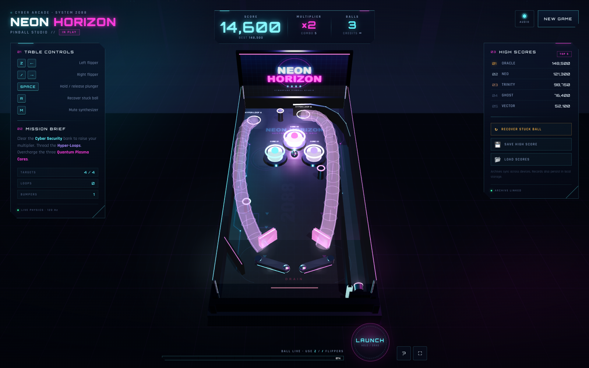

# NEON HORIZON 2088

**Cyberpunk 3D Pinball Studio** — a complete, production-ready 3D pinball game for the browser. No game engine, no pre-rendered art, no audio files: just Three.js, Cannon.js, a stack of procedural textures and a very overcharged playfield.

[](https://somphol.github.io/neon-horizon-2088/)
[](https://threejs.org/)
[](https://schteppe.github.io/cannon.js/)
[](LICENSE)



---

## The table

Neon Horizon 2088 is an inclined, glass-topped pinball cabinet rendered at 120 Hz simulated physics. A chrome fusion ball, a railgun plunger, two responsive flippers, three Quantum Plasma Cores, a bank of Cyber Security drop targets and two translucent Hyper-Loops are wired together into a single arcade session.

Everything is generated in the browser:

- **Procedural playfield art** — a 1024 × 2048 circuit-board texture with neon traces, node rings, lane arrows, warning bands and a sector watermark.
- **Procedural cabinet** — matte-black chassis, chrome rails, glass, backglass marquee, legs, underglow, a city skyline backdrop and a neon floor grid.
- **Procedural audio** — every bump, launch, target, loop and game-over chord is synthesised with the Web Audio API.
- **Portable save data** — a high-score archive that survives reloads and can be exported to `neon_horizon_scores.json` and merged back on another device.

The result runs directly from `index.html` and deploys cleanly to GitHub Pages.

---

## Contents

- [Features](#features)
- [Controls](#controls)
- [Scoring](#scoring)
- [Run it locally](#run-it-locally)
- [Project structure](#project-structure)
- [How the physics work](#how-the-physics-work)
- [Data & persistence](#data--persistence)
- [Verification](#verification)
- [Performance notes](#performance-notes)
- [Credits](#credits)
- [License](#license)

---

## Features

### Table & physics

- **Inclined cabinet** — the playfield, cabinet, glass, backglass and every collider share one 6.6° table transform. The physics world uses the projected gravity vector, so the ball accelerates down the real slope.
- **Chrome fusion ball** — a high-metalness sphere with a procedurally generated reflection environment, a soft light attached to the ball, a pulsing halo and a comet trail. Zero-friction wall contacts and high restitution keep bounces lively.
- **Railgun launch accelerator** — hold **Space** (or hold/drag the on-screen **LAUNCH** pad) to compress the spring. The charge meter fills, the charge oscillator rises in pitch and the plunger physically pulls back. Release to apply a linear impulse up the shooter lane.
- **Dual flippers** — left **Z / ←**, right **/ / →**. Kinematic bodies rotate around their pivot at a controlled angular velocity; the moving arm imparts momentum through the solver. Active flippers light their neon edge.
- **120 Hz fixed-step simulation** — an accumulator keeps the simulation stable at any display rate, with a speed clamp that prevents tunnelling.
- **Anti-trap recovery** — a displacement watchdog detects a ball that has stopped making progress (without interrupting a deliberate flipper cradle). It returns the ball to the shooter lane, preserving the score and ball count. The right-side clearances between the bumper/sling/peg and the shooter-lane divider are tuned above one ball diameter so the ball cannot wedge there, and a manual **R / RECOVER STUCK BALL** control is always available.
- **Live table behaviour** — bumper kicks, slingshot kicks, drain detection, camera shake, spark bursts and neon light flashes.

### Playfield features

| Feature | Behaviour |
| --- | --- |
| **3 Quantum Plasma Cores** | Cyan, magenta and electric-violet cylinder bumpers. A ball impact adds score, flashes a point light, pulses the core/ring scale, emits sparks and kicks the ball outward. |
| **Cyber Security Nodes** | Four vertical drop targets. Each hit sinks a node and scores. Clearing the whole bank raises the multiplier (up to ×8), awards a bonus and re-arms the bank after a short delay. |
| **Hyper-Loops** | Two translucent neon-purple wire tubes. The ball is captured at the glowing entrance, rides the curve with a rising synth whoosh, then is released toward the flippers with a bonus. |
| **Slingshots** | Angled live kickers above the flippers, with magenta flash and a short cooldown. |
| **Outlanes & drain** | The funnel walls, flipper gap and drain line are real colliders. Three balls per session; the game over screen archives the score. |
| **Extra ball** | Cross 100,000 points for one extra ball, once per session. |

### Audio

- Web Audio API only: no `.mp3`, `.wav` or external audio assets.
- A low detuned cybernetic hum with a slow filter LFO runs under the table.
- Separate synthesised voices for flippers, bumpers, targets, slingshots, wall impacts, loop entry/exit, launch, drain, multiplier-up, extra ball and game over.
- **M** mutes/unmutes; the preference is stored in `localStorage`.
- Audio starts on the first user gesture and suspends politely when the tab is hidden.

### Scores & persistence

- Top scores are kept in `localStorage` under `neon_horizon_scores_v1`; the best score is also mirrored to `neon_horizon_best_v1`.
- The top five are shown in the live HUD, up to 30 are retained in the archive.
- **💾 SAVE HIGH SCORE** downloads `neon_horizon_scores.json` with all records, the current session snapshot and credits.
- **📂 LOAD SCORES** accepts that file on another device: entries are validated, HTML-stripped, de-duplicated and merged into the local archive.
- Game over automatically archives the run, so the leaderboard is current even before an export.

### UI / UX

- Glassmorphic HUD with clipped-corner neon panels, scanline overlays and responsive typography.
- Live **Score**, **Multiplier**, **Balls**, **Best**, **Combo**, target count, loop count and bumper count.
- Railgun charge meter driven by real physics input.
- Start hero screen with callsign entry, feature readouts and a full operator manual.
- Game-over summary: final score, archive rank, best multiplier, targets cleared, loops and session time.
- Mobile layout with two large touch flip pads, a hold-and-drag launch pad, a slide-in high-score drawer and a scores toggle.
- Resize/orientation safe: renderer and camera reconfigure on every viewport change.
- Keyboard, mouse and touch inputs; reduced-motion-friendly CSS.

---

## Controls

| Action | Keyboard | Touch / mouse |
| --- | --- | --- |
| Left flipper | `Z` or `←` | Left **FLIP** pad, or tap/click the left half of the table |
| Right flipper | `/` or `→` | Right **FLIP** pad, or tap/click the right half |
| Charge railgun | Hold `Space` | Hold the **LAUNCH** pad; drag upward to add charge |
| Launch ball | Release `Space` | Release the **LAUNCH** pad |
| Recover stuck ball | `R` | **RECOVER STUCK BALL** in the scores panel |
| Mute / unmute | `M` | Audio button |
| Help | `H` or `?` | `?` button |
| New game | — | **NEW GAME** button |
| Close a dialog | `Esc` | × / backdrop |

---

## Scoring

| Event | Points |
| --- | ---: |
| Plasma core hit | 500 × multiplier |
| Slingshot hit | 120 × multiplier |
| Cyber Security node | 900 × multiplier |
| Security bank cleared | 5,000 + multiplier increase |
| Hyper-Loop entry | 2,500 × multiplier |
| Hyper-Loop exit | 500 × multiplier |
| Extra ball | at 100,000 points |

Combo hits are tracked in the HUD. The multiplier resets when a ball drains, so banks should be cleared while the ball is alive.

---

## Run it locally

The project is three files and two CDN libraries. No build step, no package manager, no node_modules.

```bash
git clone https://github.com/somphol/neon-horizon-2088.git
cd neon-horizon-2088
python3 -m http.server 8000
# open http://localhost:8000/
```

You can also open `index.html` directly, but a local HTTP server is recommended for module-free CDN loading and for stable localStorage origins.

The runtime needs an internet connection the first time because Three.js r128 and Cannon.js 0.6.2 are loaded from cdnjs, and the display fonts come from Google Fonts. All game art and audio are generated locally.

### Deploy to GitHub Pages

The repository includes `.nojekyll` and uses only relative paths.

1. Push the repository to GitHub.
2. **Settings → Pages → Build and deployment → Deploy from a branch**.
3. Choose `main` and `/ (root)`.
4. The game is live at `https://<username>.github.io/neon-horizon-2088/`.

---

## Project structure

```text
neon-horizon-2088/
├── index.html              # semantic HUD, overlays, hero, controls, modals
├── style.css               # cyberpunk design system and responsive layout
├── script.js               # Three.js scene, Cannon.js physics, audio, game logic
├── favicon.svg             # neon hex/orb mark
├── screenshot.png          # 1600 × 1000 desktop gameplay
├── screenshot-mobile.png   # 390 × 844 @2× mobile gameplay
├── screenshot-start.png    # 1600 × 1000 hero / start screen
├── state.json              # build duration, token usage and credits
├── STATE.md                # human-readable build state
├── THIRD_PARTY_NOTICES.md  # library and font licences
├── LICENSE                 # MIT
├── .nojekyll               # GitHub Pages passthrough
└── README.md
```

### Code map

`script.js` is organised into numbered sections:

1. Utilities and constants.
2. Synthesised arcade audio.
3. Persistence and leaderboard archive.
4. DOM references and UI helpers.
5. Renderer, scene and responsive camera.
6. Procedural textures and shared materials.
7. Scene construction (cabinet, backglass, lane guides, pegs).
8. Cannon.js physics world and contact materials.
9. Game objects (cores, targets, slingshots, loops, plunger, ball, flippers).
10. Ball, plunger and Hyper-Loop rail logic.
11. Spark particle system.
12. Game state and flow.
13. Fixed-step simulation and render loop.
14. Score export/import.
15. UI and input wiring.
16. Self-test API.
17. Boot sequence.

---

## How the physics work

### One table, one transform

All gameplay geometry is authored in **table-local coordinates**: `x` is width, `y` is the playfield normal, `z` runs from the far end (`-11`) to the flippers (`+11`). The whole `tableGroup` is rotated by **6.6°** around X, so the far end is lifted and the near end slopes toward the player.

The physics world stays in table-local space. Instead of rotating every collider, the gravity vector is projected onto the slope:

```js
world.gravity.set(
  0,
  -9.82 * Math.cos(TABLE.tilt),   // into the playfield
   9.82 * Math.sin(TABLE.tilt)    // down the table
);
```

That makes the ball roll toward the flippers while keeping the collider geometry simple and stable.

### Fixed step

```js
accumulator += frameDelta;
while (accumulator >= 1 / 120 && steps < 6) {
  fixedUpdate(1 / 120);
  accumulator -= 1 / 120;
}
```

The solver runs 22 iterations with a speed clamp of 28 units/s. The ball is a sphere with low damping; wall contacts use zero friction and 0.62 restitution, bumper contacts use 0.9 restitution, and the playfield uses just enough friction to make the ball roll naturally.

### Flippers

Each flipper is a **kinematic** body with a box shape offset from its pivot. Every physics step the target angle (rest or active) is approached at a capped angular velocity; the body quaternion and `angularVelocity` are updated before `world.step`, so the moving arm transfers momentum to the ball through the solver. The same angle drives the visual arm, so there is no render/physics drift.

### Hyper-Loop rail

The loops are visual `TubeGeometry` curves plus a trigger sphere at the entrance. On entry the ball becomes kinematic and is moved along a `CatmullRomCurve3` for a short ride; at the exit it becomes dynamic again and receives a tangent impulse toward the flippers. This gives a reliable, readable loop without fragile tube colliders.

### Anti-trap recovery

Narrow gaps are the enemy of a pinball table. The right-side bumper, sling and peg are deliberately kept more than one ball diameter away from the shooter-lane divider, and the drop-target bank will not re-arm on top of a live ball.

As a final safety net, the ball's position is sampled against a rolling anchor. If it stays within a 0.8-unit circle for 3.5 seconds while neither flipper is held, `recoverBall()` returns it to the shooter lane without spending a ball or resetting the score. A deliberate flipper cradle resets the watchdog, and **R** / **RECOVER STUCK BALL** triggers the same recovery manually.

---

## Data & persistence

### Archive format

```json
{
  "app": "NEON HORIZON 2088",
  "version": "1.0.0",
  "exportedAt": "2026-11-01T04:20:00.000Z",
  "highScore": 148500,
  "scores": [
    {
      "id": "nh-oracle",
      "name": "ORACLE",
      "score": 148500,
      "date": "2026-06-14T21:12:00.000Z",
      "maxMultiplier": 5,
      "loops": 18,
      "targets": 7
    }
  ],
  "currentSession": { "callsign": "ORACLE", "score": 14600, "multiplier": 2 }
}
```

Import accepts:

- the full export object,
- an object with a `scores` array,
- an object with a `leaderboard` array,
- or a raw array of entries.

Invalid scores, missing names, oversized files (>2 MB) and non-JSON files are rejected with an on-screen toast. Names are stripped of markup and capped at 14 characters.

### Local storage keys

| Key | Purpose |
| --- | --- |
| `neon_horizon_scores_v1` | Archived score entries |
| `neon_horizon_best_v1` | Mirrored all-time best |
| `neon_horizon_callsign_v1` | Last used runner name |
| `neon_horizon_muted_v1` | Audio mute preference |

Storage access is wrapped in `try/catch`, so private browsing or a full quota degrades gracefully.

---

## Verification

The project includes a built-in self-test surface:

```text
https://somphol.github.io/neon-horizon-2088/?selftest=1
```

`window.NEON_HORIZON.selfTest()` currently reports **16/16 passes**: score/time formatting, callsign sanitisation, Three.js and Cannon.js presence, table tilt, 3 cores, 4 targets, 2 loops, 2 flippers, ball collider, physics world, leaderboard storage, JSON serialisability, audio API, and the export filename.

Automated Chrome end-to-end runs additionally verified:

- Full-charge railgun launch from the shooter lane, up the curved guide, around the top and down the playfield.
- Hyper-Loop capture, rail ride and flipper-side release.
- Bumper hit, plasma flash, spark burst and outward kick.
- Drop-target hit, bank clear, multiplier increase, delayed re-arm.
- Left/right flipper motion and ball momentum transfer.
- Slingshot hits.
- Drain → ball countdown → respawn.
- Right-side wedge clearance at the bumper, slingshot and peg against the shooter-lane divider.
- Automatic anti-trap recovery after 3.5 s of no progress, and manual recovery via **R** and the **RECOVER STUCK BALL** button, with score and ball count preserved.
- Three-ball game over, auto-archive, final summary and leaderboard rank.
- `neon_horizon_scores.json` export and a merge import with invalid entries rejected.
- Callsign persistence and audio mute persistence.
- Mobile touch launch, touch flippers, slide-in score drawer, help modal and new-game confirmation.
- Viewport resize from 1600 × 1000 → 768 × 1024 → 390 × 844 → 320 × 568 without canvas or camera breakage.
- **0** uncaught exceptions and **0** console errors in the final run.

Self-test and gameplay checks were run in headless Chrome with SwiftShader, so the results are reproducible without a GPU.

---

## Performance notes

- Typical scene cost: **~180 draw calls**, **~27k triangles**.
- Pixel ratio is capped at 2 on desktop and 1.7 on small screens.
- Shadow map is 2048² on desktop and 1024² on mobile.
- Glass, tubes and particles use additive/transparent materials with `depthWrite: false`; the neon look is emissive plus a handful of point lights and glow sprites rather than a post-processing pass.
- Physics is fixed-step and deterministic enough for consistent table behaviour; the render loop is independent.

---

## Credits

**Built with [OpenCode](https://opencode.ai) 2.2.5 and DeepSeek V4.1 Flash** (`opencode-go/deepseek-v4.1-flash`) in a single agent session. The table geometry, physics tuning, procedural textures, UI, audio synthesis, score archive and verification harness were generated for this project.

Runtime libraries and assets:

- [Three.js](https://threejs.org/) r128 — MIT.
- [Cannon.js](https://schteppe.github.io/cannon.js/) 0.6.2 — MIT.
- [Orbitron](https://fonts.google.com/specimen/Orbitron) and [Rajdhani](https://fonts.google.com/specimen/Rajdhani) via Google Fonts — SIL Open Font License 1.1.
- cdnjs for library delivery.
- No image, texture, audio or 3D model assets were used. Every visual and sound is generated at runtime.

See [THIRD_PARTY_NOTICES.md](THIRD_PARTY_NOTICES.md) for details.

Build metrics, session ID, token usage and the model attribution are recorded in [state.json](state.json) and [STATE.md](STATE.md).

---

## License

MIT © 2026 Somphol Boonjing. See [LICENSE](LICENSE).
